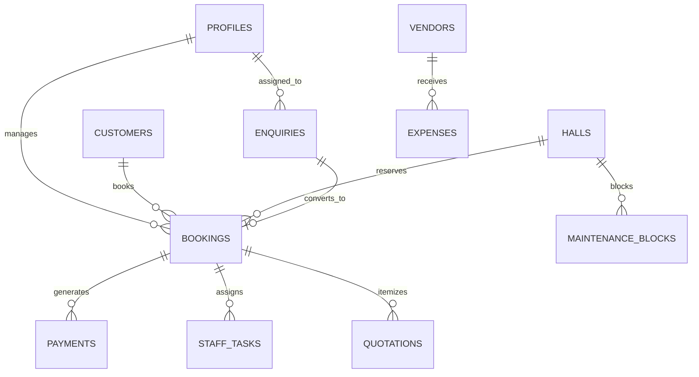

# Database Architecture & Relational Schema Specification

> **Application:** Thekkanath Souparnika Auditorium Management Web App  
> **Database Engine:** PostgreSQL 15+ / Supabase  
> **Schema File:** `supabase/migrations/20261017000000_init_schema.sql`  
> **Seed File:** `supabase/seed.sql`

---

## 1. Relational Entity Overview

The database is structured around 14 relational tables enforcing referential integrity, check constraints, and row-level security.



---

## 2. Table Specifications

### 2.1 `public.venue_settings`
Global venue metadata, location, contact coordinates, and operating defaults.
- `id` (TEXT, PK): Single-record identifier `'core-settings'`.
- `venue_name` (TEXT, NOT NULL): `'Thekkanath Souparnika'`.
- `descriptor` (TEXT, NOT NULL): `'Hall & Events Venue'`.
- `street_address` (TEXT, NOT NULL): `'Opposite RGLP School, Market Junction'`.
- `locality` (TEXT, NOT NULL): `'Nellikunnu'`.
- `city` (TEXT, NOT NULL): `'Thrissur'`.
- `pincode` (TEXT, NOT NULL): `'680005'`.
- `state` (TEXT, NOT NULL): `'Kerala'`.
- `country` (TEXT, NOT NULL): `'India'`.
- `primary_phone` (TEXT, NOT NULL): `'8129764370'`.
- `secondary_phone` (TEXT, NOT NULL): `'9446143165'`.
- `email` (TEXT, NOT NULL): `'thekkanathsouparnika@gmail.com'`.
- `maps_url` (TEXT): Google Maps directions link.
- `timezone` (TEXT, NOT NULL DEFAULT `'Asia/Kolkata'`).

### 2.2 `public.halls`
The 4 verified spaces from the venue brochure:
- `id` (TEXT, PK): `'hall-stage'`, `'hall-welcome'`, `'hall-dining'`, `'hall-open'`.
- `slug` (TEXT, UNIQUE): URL path identifier.
- `name` (TEXT, NOT NULL): Full hall name.
- `floor` (TEXT, NOT NULL): Building floor level.
- `capacity_text` (TEXT, NOT NULL): Stated brochure capacity.
- `capacity_number` (INT, NOT NULL, CHECK <= 100): Fixed ceiling of 100 guests per hall.
- `air_conditioned` (BOOLEAN, NOT NULL): AC configuration (`false` for Open Hall, `true` for others).
- `cover_image` (TEXT, NOT NULL): Path to local or CDN image asset.
- `description` (TEXT, NOT NULL): Architectural and functional description.
- `soundproofing_notes` (TEXT): Includes explicit acoustic caveat for Open Hall (exhaust fans).
- `published` (BOOLEAN DEFAULT TRUE): Public visibility toggle.
- `sort_order` (INT DEFAULT 0).

### 2.3 `public.profiles`
Staff user profiles linked directly to Supabase authentication:
- `id` (UUID, PK): References `auth.users(id)` ON DELETE CASCADE.
- `full_name` (TEXT, NOT NULL).
- `email` (TEXT, NOT NULL UNIQUE).
- `phone` (TEXT).
- `role` (TEXT, CHECK IN: `'super_admin'`, `'administrator'`, `'booking_manager'`, `'operations_manager'`, `'accounts'`, `'staff'`, `'vendor'`, `'customer'`).

### 2.4 `public.customers`
Customer relationship repository:
- `id` (UUID, PK DEFAULT uuid_generate_v4()).
- `name` (TEXT, NOT NULL).
- `phone` (TEXT, NOT NULL UNIQUE): Primary search key and communication handle.
- `email` (TEXT).
- `address` (TEXT).
- `total_bookings` (INT DEFAULT 0).
- `notes` (TEXT).

### 2.5 `public.enquiries`
Public inbound inquiries and event lead pipeline:
- `id` (UUID, PK).
- `reference` (TEXT, UNIQUE): Formatted reference code (e.g. `TS-ENQ-2026-081`).
- `customer_name` (TEXT, NOT NULL).
- `customer_phone` (TEXT, NOT NULL).
- `customer_email` (TEXT).
- `event_type` (TEXT, NOT NULL).
- `preferred_date` (DATE, NOT NULL).
- `start_time` (TIME, NOT NULL).
- `end_time` (TIME, NOT NULL).
- `preferred_hall_id` (TEXT, FK -> halls.id).
- `estimated_guests` (INT, CHECK <= 300).
- `special_requests` (TEXT).
- `consent_given` (BOOLEAN DEFAULT false).
- `status` (TEXT, CHECK IN: `'new'`, `'contacted'`, `'needs_info'`, `'site_visit_scheduled'`, `'quotation_in_progress'`, `'quoted'`, `'converted_to_booking'`, `'lost'`, `'closed'`).
- `lost_reason` (TEXT).
- `assigned_staff_id` (UUID, FK -> profiles.id).
- `notes` (TEXT).

### 2.6 `public.bookings`
Confirmed reservations and tentative holds:
- `id` (UUID, PK).
- `reference` (TEXT, UNIQUE): Formatted code (e.g. `TS-BKG-2026-104`).
- `enquiry_id` (UUID, FK -> enquiries.id).
- `customer_id` (UUID, FK -> customers.id).
- `customer_name` (TEXT, NOT NULL).
- `customer_phone` (TEXT, NOT NULL).
- `hall_id` (TEXT, NOT NULL, FK -> halls.id).
- `hall_name` (TEXT, NOT NULL).
- `event_type` (TEXT, NOT NULL).
- `event_date` (DATE, NOT NULL).
- `start_time` (TIME, NOT NULL).
- `end_time` (TIME, NOT NULL).
- `guest_count` (INT, CHECK <= 300).
- `status` (TEXT, CHECK IN: `'tentative_hold'`, `'reviewing'`, `'quotation_sent'`, `'confirmed'`, `'in_progress'`, `'completed'`, `'cancelled'`).
- `hold_expires_at` (TIMESTAMPTZ).
- `total_agreed_paise` (BIGINT): Integer amount in paise (1 INR = 100 paise).
- `advance_paid_paise` (BIGINT DEFAULT 0).
- `special_requirements` (TEXT).
- `assigned_manager_id` (UUID, FK -> profiles.id).
- `cancellation_reason` (TEXT).
- CONSTRAINT: `start_time < end_time`.

### 2.7 `public.maintenance_blocks`
Scheduled blackout windows preventing reservations during repairs:
- `id` (UUID, PK).
- `hall_id` (TEXT, FK -> halls.id).
- `hall_name` (TEXT, NOT NULL).
- `start_date` (DATE, NOT NULL).
- `end_date` (DATE, NOT NULL).
- `start_time` (TIME, NOT NULL).
- `end_time` (TIME, NOT NULL).
- `title` (TEXT, NOT NULL).
- `reason` (TEXT).
- `status` (TEXT, CHECK IN: `'scheduled'`, `'in_progress'`, `'completed'`).
- `assigned_to` (TEXT).

### 2.8 `public.payments`
Financial ledger and payment receipts:
- `id` (UUID, PK).
- `reference` (TEXT, UNIQUE): E.g. `TS-REC-2026-091`.
- `booking_id` (UUID, FK -> bookings.id).
- `booking_reference` (TEXT, NOT NULL).
- `customer_name` (TEXT, NOT NULL).
- `amount_paise` (BIGINT, CHECK > 0).
- `payment_method` (TEXT, CHECK IN: `'cash'`, `'bank_transfer'`, `'upi'`, `'cheque'`).
- `transaction_reference` (TEXT): Bank UTR / Cheque No / UPI Transaction ID.
- `status` (TEXT, CHECK IN: `'completed'`, `'pending'`, `'refunded'`).
- `notes` (TEXT).
- `recorded_by` (TEXT, NOT NULL).
- `received_at` (TIMESTAMPTZ NOT NULL).

### 2.9 `public.expenses`
Operational disbursements and facility upkeep:
- `id` (UUID, PK).
- `category` (TEXT, CHECK IN: Utilities, Salaries, Repairs, Cleaning, Supplies, Marketing, Software, Insurance, Other).
- `description` (TEXT, NOT NULL).
- `amount_paise` (BIGINT, CHECK > 0).
- `vendor_name` (TEXT).
- `expense_date` (DATE, NOT NULL).
- `payment_method` (TEXT, NOT NULL).
- `status` (TEXT, CHECK IN: `'paid'`, `'pending'`).
- `recorded_by` (TEXT, NOT NULL).

### 2.10 `public.staff_tasks`
Operational event staging and handover checklist items:
- `id` (UUID, PK).
- `booking_id` (UUID, FK -> bookings.id).
- `title` (TEXT, NOT NULL).
- `hall_name` (TEXT).
- `assigned_to` (TEXT, NOT NULL).
- `priority` (TEXT, CHECK IN: `'low'`, `'medium'`, `'high'`, `'urgent'`).
- `stage` (TEXT, CHECK IN: `'pre_event'`, `'setup'`, `'event_day'`, `'cleanup'`, `'post_event'`).
- `status` (TEXT, CHECK IN: `'todo'`, `'in_progress'`, `'blocked'`, `'done'`).
- `due_date` (DATE, NOT NULL).

### 2.11 `public.vendors`
Registered external suppliers (catering, AV, florist, HVAC, power):
- `id` (UUID, PK).
- `name` (TEXT, NOT NULL).
- `category` (TEXT, NOT NULL).
- `contact_person` (TEXT, NOT NULL).
- `phone` (TEXT, NOT NULL).
- `email` (TEXT).
- `status` (TEXT, CHECK IN: `'active'`, `'inactive'`).

### 2.12 `public.quotations`
Customer price estimates with versioning:
- `id` (UUID, PK).
- `reference` (TEXT, UNIQUE): E.g. `TS-QUO-2026-051`.
- `booking_id` (UUID, FK -> bookings.id).
- `enquiry_id` (UUID, FK -> enquiries.id).
- `customer_name` (TEXT, NOT NULL).
- `subtotal_paise` (BIGINT, NOT NULL).
- `discount_paise` (BIGINT DEFAULT 0).
- `tax_paise` (BIGINT DEFAULT 0).
- `total_paise` (BIGINT NOT NULL).
- `status` (TEXT, CHECK IN: `'draft'`, `'approved_internally'`, `'sent'`, `'accepted'`, `'rejected'`, `'expired'`).
- `valid_until` (DATE, NOT NULL).

### 2.13 `public.documents`
Document registry for venue contracts, floor plans, and statutory licenses:
- `id` (UUID, PK).
- `name` (TEXT, NOT NULL).
- `category` (TEXT, CHECK IN: quotation, receipt, contract, maintenance, brochure, license).
- `file_size` (TEXT, NOT NULL).
- `storage_path` (TEXT).
- `uploaded_by` (TEXT, NOT NULL).

### 2.14 `public.audit_logs`
Immutable compliance action trail:
- `id` (UUID, PK).
- `actor_name` (TEXT, NOT NULL).
- `actor_role` (TEXT, NOT NULL).
- `action` (TEXT, NOT NULL).
- `target_type` (TEXT, NOT NULL).
- `target_id` (TEXT, NOT NULL).
- `details` (TEXT, NOT NULL).
- `timestamp` (TIMESTAMPTZ NOT NULL DEFAULT timezone('utc'::text, now())).

---

## 3. Atomic Overlap Detection Stored Procedure

To eliminate double-bookings at the database layer under concurrent connections, the following stored procedure is executed prior to any booking insertion or date/time amendment:

```sql
CREATE OR REPLACE FUNCTION public.check_hall_booking_conflict(
  p_hall_id TEXT,
  p_event_date DATE,
  p_start_time TIME,
  p_end_time TIME,
  p_exclude_booking_id UUID DEFAULT NULL
)
RETURNS TABLE (
  conflict_found BOOLEAN,
  conflict_type TEXT,
  conflict_reference TEXT,
  conflict_start TIME,
  conflict_end TIME
)
LANGUAGE plpgsql
SECURITY DEFINER
AS $$
BEGIN
  -- 1. Check existing active bookings for overlapping time range
  -- Standard interval collision condition: (StartA < EndB) AND (EndA > StartB)
  RETURN QUERY
  SELECT 
    true AS conflict_found,
    'booking'::TEXT AS conflict_type,
    b.reference AS conflict_reference,
    b.start_time AS conflict_start,
    b.end_time AS conflict_end
  FROM public.bookings b
  WHERE b.hall_id = p_hall_id
    AND b.event_date = p_event_date
    AND b.status NOT IN ('cancelled', 'completed')
    AND (p_exclude_booking_id IS NULL OR b.id != p_exclude_booking_id)
    AND (
      b.status != 'tentative_hold' OR 
      (b.hold_expires_at IS NULL OR b.hold_expires_at > timezone('utc'::text, now()))
    )
    AND (p_start_time < b.end_time AND p_end_time > b.start_time)
  LIMIT 1;

  IF FOUND THEN
    RETURN;
  END IF;

  -- 2. Check scheduled maintenance blocks
  RETURN QUERY
  SELECT 
    true AS conflict_found,
    'maintenance'::TEXT AS conflict_type,
    m.title AS conflict_reference,
    m.start_time AS conflict_start,
    m.end_time AS conflict_end
  FROM public.maintenance_blocks m
  WHERE m.hall_id = p_hall_id
    AND p_event_date BETWEEN m.start_date AND m.end_date
    AND m.status != 'completed'
    AND (p_start_time < m.end_time AND p_end_time > m.start_time)
  LIMIT 1;
END;
$$;
```

---

## 4. Row Level Security (RLS) Policies

All 14 tables have RLS enabled (`ALTER TABLE ... ENABLE ROW LEVEL SECURITY`).
- **Public Read Access:** Granted on `halls` and `venue_settings` for anonymous visitors.
- **Enquiry Insertion:** Anonymous public visitors can insert into `enquiries` with mandatory consent validation.
- **Authenticated Staff Operations:** Staff roles have read access to operational tables.
- **Admin/Accounts Access:** Financial ledger (`payments`, `expenses`, `quotations`) is restricted to `'super_admin'`, `'administrator'`, and `'accounts'`.
- **Audit Logs:** Strictly write-only/read-only (immutable); updates and deletions are disabled.
